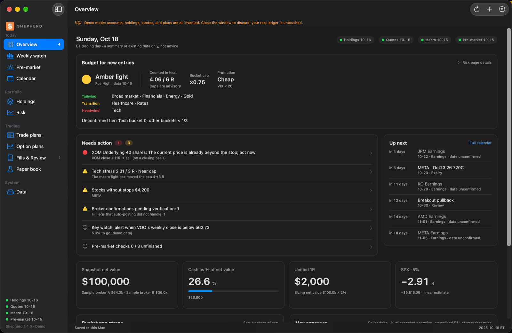
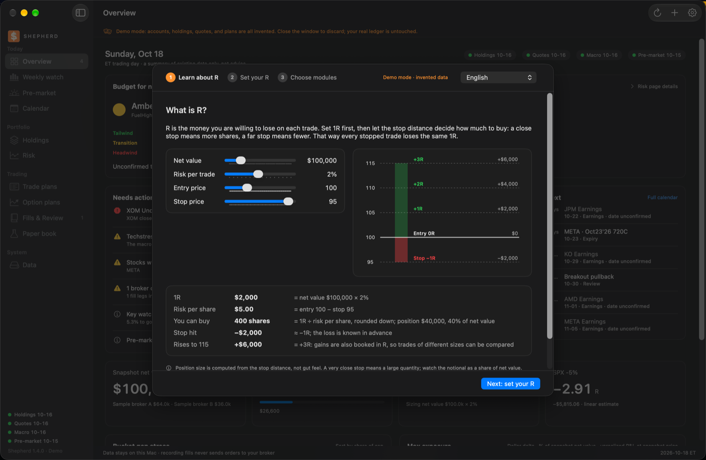
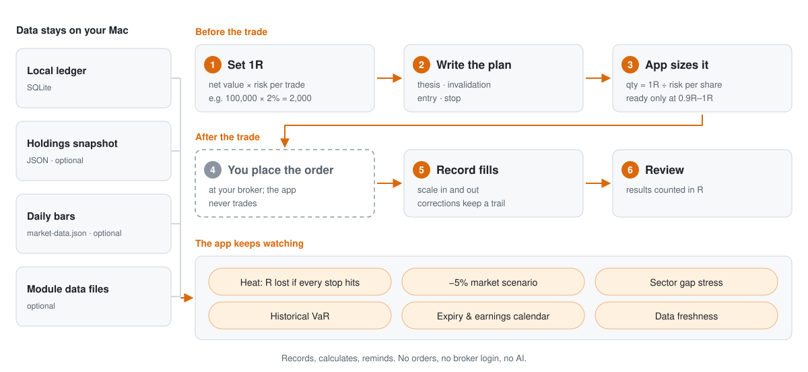
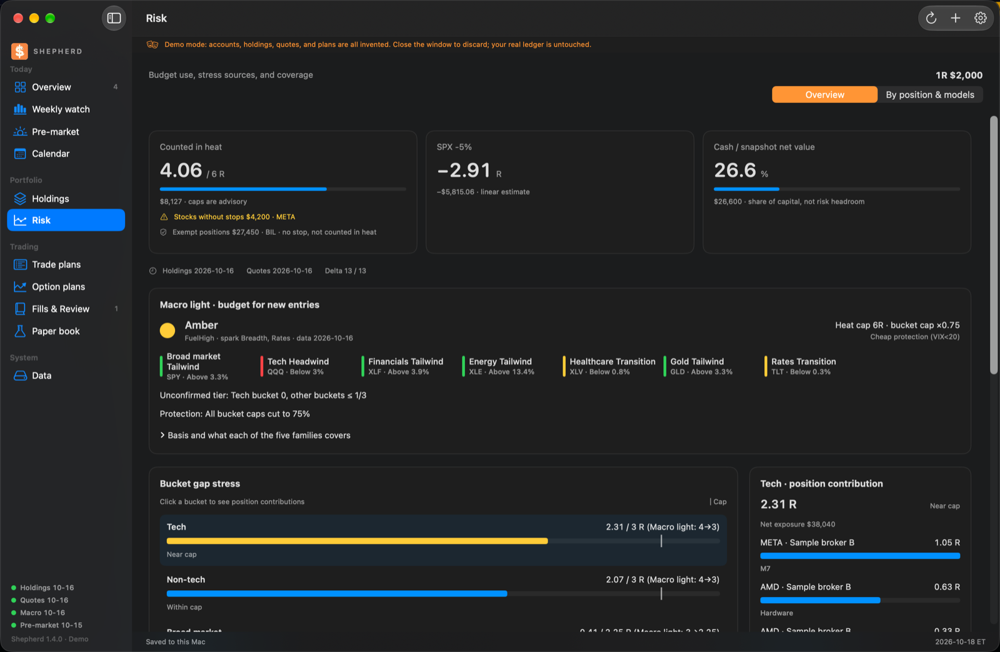
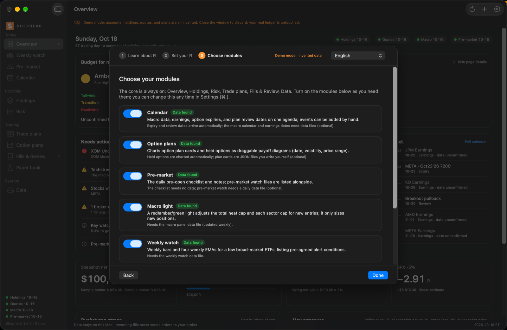
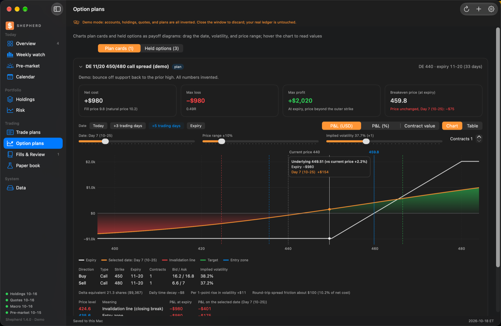

# Shepherd · a risk-first trading desk for macOS

[简体中文](README.md) · [繁體中文](README.zh-TW.md) · English

<p align="center">
  <a href="https://github.com/NexusKFK/shepherd/releases/latest"></a>
  <a href="LICENSE"></a>
  
  <a href="https://github.com/NexusKFK/shepherd/actions/workflows/ci.yml"></a>
</p>

Shepherd is a native macOS app that does the arithmetic of position sizing before you trade. You decide how much one trade may lose (1R); Shepherd turns the distance to your stop into a share count, and afterwards keeps telling you how many R you would lose if every stop were hit at once ("heat").

It records, calculates and reminds. It never places orders, never logs in to a broker, gives no buy/sell advice and calls no AI model. Everything stays on your Mac. The interface is in English, Simplified Chinese and Traditional Chinese; it follows the system language and can be changed in Settings (⌘,).

<p align="center"></p>

> All screenshots come from the built-in demo; every account, position and price is randomly generated.

## R in one table

| | Value | Where it comes from |
|---|---|---|
| 1R | $2,000 | net value $100,000 × 2% per trade |
| Risk per share | $5 | entry 100 − stop 95 |
| Shares | 400 | 1R ÷ risk per share, rounded down |
| Stopped out | −$2,000 | exactly −1R, known in advance |
| At 115 | +$6,000 | +3R; gains are counted in R too |

A near stop buys more shares, a far stop fewer, so every stopped-out trade costs the same 1R. The first launch walks through this with an interactive example and asks you to set your own 1R before any plan can be sized.

<p align="center"></p>

## How it works

Before the trade you set 1R and write the plan, and the app sizes it. You place the order at your broker and record the fill. The whole time, the app watches heat and risk.

<picture>
  <source media="(prefers-color-scheme: dark)" srcset="docs/img/flow-en-dark.svg">
  
</picture>

## Getting started

1. Download `Shepherd-v1.4.0-macOS-arm64.zip` from [Releases](../../releases), unzip, and drag `Shepherd.app` into Applications. Apple silicon only, macOS 14 or later.
2. The app is not notarized. On first launch open **System Settings → Privacy & Security** and click **Open Anyway**. If it still refuses, run `xattr -dr com.apple.quarantine /Applications/Shepherd.app`.
3. Follow the three-step walkthrough: what R is, set your R, pick modules.
4. To see everything populated: **File → Open demo (invented data)** opens a second window on invented data that is discarded when closed.
5. Language, appearance, 1R and modules live in **Settings**: press ⌘, or click the gear at the top right of the toolbar.

## Core pages and optional modules

Always on: Overview, Holdings, Risk (heat, a −5% market scenario, sector gap stress, historical VaR), Trade plans (thesis, invalidation, exits; sized to 0.9R–1R), Fills & review, Data.

<p align="center"></p>

Optional, chosen on first run and changeable in **Settings → Modules**: Calendar, Option plans (interactive payoff charts), Pre-market checklist, Macro light (scales the heat and sector caps for new risk), Weekly watch, Paper book, Schwab confirmation import. A module that is off disappears from the sidebar, raises nothing on the overview and drops its freshness dot.

<p align="center"></p>

<p align="center"></p>

## Data

Shepherd does not fetch data itself. Start with the ledger alone (plans and fills entered in the app), then add what you need:

- a holdings snapshot JSON, imported under **Data → Import holdings JSON…** — see [`examples/holdings-template.json`](examples/holdings-template.json);
- daily closes for Beta, the market scenario and VaR: `python3 tools/fetch_market_data.py AAPL MSFT` (Yahoo chart endpoint; SPY and the S&P 500 are added automatically);
- one JSON file per optional module, documented in [docs/data-formats.md](docs/data-formats.md). `python3 -m workbench.demo --out /tmp/shepherd-demo` writes a complete set of examples.

## Sizing rules (the author's choices)

1R = confirmed net value × risk per trade (default 2%, capped at 4%). A full plan must use 0.9R–1R; quantities round down. Changing 1R affects only later plans. Long options risk the whole premium; short structures are accepted only with a confirmed maximum loss per set. Heat cap 8R and sector caps (tech 4R, non-tech 4R, broad market 3R, gold 2R, rates 2R) are prompts, not blocks. Stops are judged on closing prices; gaps, slippage and fees can make a real loss larger than 1R.

## Building

macOS 14+, Xcode command line tools (Swift 5.9+), and a python.org framework Python 3.10+ to bundle the runtime.

```sh
./build-workbench.sh && ./install-workbench.sh
python3 -m unittest discover -p 'test_*.py'
```

The SwiftUI front end talks to a bundled Python engine over a private stdio pipe; all calculations live in `workbench/` and are unit-tested.

## Disclaimer

A personal record-keeping and risk-arithmetic tool, not investment advice. Numbers depend on your inputs and on simplified models (linear delta, historical quantiles). You are responsible for your trades.

## License

[Changelog](CHANGELOG.md) · [Contributing](CONTRIBUTING.md) · [Security](SECURITY.md) · [Data formats](docs/data-formats.md)


[GPL-3.0](LICENSE). By [NexusKFK](https://github.com/NexusKFK). Also by the author: [Whirlpool](https://github.com/NexusKFK/whirlpool), an LED ticker for the macOS menu bar.
