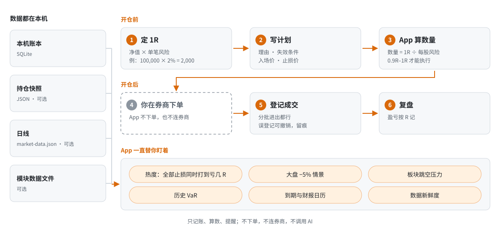

# Shepherd 牧羊犬 · 以损定仓的交易工作台

简体中文 · [繁體中文](README.zh-TW.md) · [English](README.en.md)

<p align="center">
  <a href="https://github.com/NexusKFK/shepherd/releases/latest"></a>
  <a href="LICENSE"></a>
  
  <a href="https://github.com/NexusKFK/shepherd/actions/workflows/ci.yml"></a>
</p>

Shepherd 是一个 macOS 本机 App。它帮你在开仓之前把风险算清楚：先定好每笔愿意亏的钱（1R），再按止损距离算出该买多少；开仓之后，随时告诉你"所有止损同时被打到，一共会亏多少 R"。

名字取自牧羊犬：放牧的方向由你定，它负责看住羊群，有羊走散了就叫。

它只记账、算数、提醒。它不下单，不登录券商，不给买卖建议，也不调用任何 AI 模型。所有记录都存在你自己的电脑上。

界面有简体中文、繁体中文和英文三种，默认跟随系统语言，可以在设置（⌘,）里改。

<p align="center"></p>

> 截图全部来自演示模式，账户、持仓和行情都是随机生成的。

## 它能做什么

- **定仓**：先定每笔愿意亏的钱（1R），每个计划按止损距离算出股数或张数。计划里写清理由、失效条件和退出安排，用到 0.9R–1R 才能标成待执行。
- **组合风险**：热度（所有止损同时被打到会亏多少 R）、大盘跌 5% 的线性估算、各板块的跳空压力、历史 VaR，以及每个持仓的 Delta、Beta、波动率和行业集中度。
- **持仓与记账**：几个券商账户的持仓放在一张表里，期权组合能展开看每条腿。分批进出的成交都能登记，登记错了能撤销，原记录留痕。Schwab 的成交确认单能自动解析成待核对的记录。
- **期权盈亏图**：计划中的和已持有的期权都能画，可以拖动日期、波动率和价格范围，并列出 Delta、每天的时间损耗和往返点差成本。
- **可选模块**：宏观灯（按大环境收放新仓上限）、周线观察（宽基 ETF 的周线和预警条件）、盘前清单、日历（财报、宏观数据、期权到期）、纸盘（只记录、不下单的模拟交易）。用得上再打开。
- **本机、可回溯**：账本是本机的 SQLite 文件，持仓快照保留历史版本，可以一键导出完整备份。

## 先搞懂 R

R 是你每一笔交易愿意亏的钱。Shepherd 里的一切都围着它转。

| | 数字 | 怎么来的 |
|---|---|---|
| 1R | $2,000 | 净值 $100,000 × 单笔风险 2% |
| 每股风险 | $5 | 入场 100 − 止损 95 |
| 能买 | 400 股 | 1R ÷ 每股风险，向下取整 |
| 打到止损 | −$2,000 | 正好 −1R，亏多少事先就知道 |
| 涨到 115 | +$6,000 | +3R，盈利也按 R 记 |

止损近就多买，止损远就少买。这样无论哪一笔被止损，亏的都是同样的 1R。第一次打开 App 时，会先用一个能拖动的例子讲这件事，再让你定自己的 1R。没有定好 1R，App 不会给出计划数量。

<p align="center"></p>

## 一张图看懂

开仓前你定 1R、写计划，App 算数量；你在券商下单，回来登记成交；整个过程中 App 一直盯着热度和风险。

<picture>
  <source media="(prefers-color-scheme: dark)" srcset="docs/img/flow-zh-CN-dark.svg">
  
</picture>

## 快速开始

1. 到 [Releases](../../releases) 下载 `Shepherd-v1.4.1-macOS-arm64.zip`，解压后把 `Shepherd.app` 拖进「应用程序」。目前只提供 Apple 芯片版本，需要 macOS 14 或更新。
2. 第一次打开时，macOS 会提示无法验证开发者，因为这个 App 没有做苹果公证。打开「系统设置 → 隐私与安全性」，在页面下方点「仍要打开」。
   如果还是打不开，在终端运行 `xattr -dr com.apple.quarantine /Applications/Shepherd.app`，再打开一次。
3. 跟着首次引导走三步：认识 R，定你的 R，选模块。
4. 想先看看完整的样子：菜单「文件（File）→ 打开演示（虚构数据）」。演示会另开一个窗口，用一套虚构的账户和行情，关掉就丢弃，不碰你的账本。
5. 以后要改语言、外观、1R 或模块，打开设置：按 ⌘,，或点工具栏右上角的齿轮。

## 一直开着的核心部分

| 页面 | 做什么 |
|---|---|
| 总览 | 打开就看到：还能开多少新仓、有什么要处理、接下来几天有什么事、数据新不新。 |
| 持仓 | 所有持仓一张表：浮盈、占净值比例、Delta 美元、到期倒计时，组合可以展开看每条腿。 |
| 风险 | 热度（所有止损同时打到会亏多少 R）、大盘跌 5% 的线性估算、按板块的跳空压力、历史 VaR。 |
| 交易计划 | 写理由、失效条件和退出安排，填入场价和止损价，App 按 1R 算数量。满足 0.9R–1R 才能标成待执行。 |
| 成交与复盘 | 登记券商里已经发生的成交（分批进出都行），误登记可以撤销，原记录留痕。 |
| 数据与留存 | 账本位置、导入持仓、快照历史版本、一键导出完整备份。 |

<p align="center"></p>

## 按需打开的模块

第一次打开时选，之后在「设置 → 模块」里随时改。没开的模块不出现在侧栏，也不会在总览报提醒，左下角也不显示它的数据灯。

<p align="center"></p>

| 模块 | 做什么 | 需要什么 | 新用户默认 |
|---|---|---|---|
| 日历 | 宏观数据、财报、期权到期、计划复核日排成一张议程，也能手动加事件。 | 到期日和复核日自动来；宏观日历和财报日期要数据文件（可选）。 | 开 |
| 期权计划 | 把期权计划卡和已持有的期权画成盈亏图，可以拖动日期、波动率和价格范围。 | 已持有的期权自动画；计划卡是你写的 JSON 文件。 | 开 |
| 盘前准备 | 开盘前的检查清单和笔记；有盘前观察文件时一并列出。 | 清单不需要数据；盘前观察要数据文件。 | 关 |
| 宏观灯 | 一盏红黄绿灯，调节新开仓的总热度上限和每个板块的上限。只管新仓大小，不叫你卖已有的仓。 | 宏观面板数据文件（每周更新）。 | 关 |
| 周线观察 | 几只宽基 ETF 的周线和四条周 EMA，列出预先约定的预警条件。 | 周线观察数据文件。 | 关 |
| 纸盘 | 只观察、不下单的模拟交易，按收盘估值，不进真实账本和风险统计。 | 纸盘估值数据文件。 | 关 |
| 券商确认单导入 | 把 Schwab 的成交确认邮件解析成提案，核对后入账。 | 把确认邮件存进投喂文件夹（可配 Mail 规则自动存）。 | 关 |

<p align="center"></p>

## 数据从哪来

Shepherd 自己不联网取数。你可以从最简单的用法开始，需要时再接数据。

1. **只用账本。** 在 App 里建计划、登记成交，持仓和热度就从账本里算。不需要任何外部文件。
2. **导入持仓快照。** 把券商持仓整理成一个 JSON 文件，在「数据与留存 → 导入持仓 JSON」导入。格式看 [`examples/holdings-template.json`](examples/holdings-template.json)。导入的是一份副本；持仓变了要重新导入。
3. **补日线。** 风险页的 Beta、大盘情景和 VaR 要用日线。运行下面这条命令，它会从 Yahoo 拉日线，写到 App 的数据目录：

   ```sh
   python3 tools/fetch_market_data.py AAPL MSFT NVDA   # 换成你持有的代码；SPY 和标普指数会自动加上
   ```

4. **接模块的数据文件。** 宏观灯、周线观察、纸盘、盘前观察、日历都读一个约定格式的 JSON 文件。格式见 [docs/data-formats.md](docs/data-formats.md)。最完整的样例是演示数据：运行 `python3 -m workbench.demo --out /tmp/shepherd-demo`，然后看 `sources/` 下面的每个文件。

作者的这些文件，由 coding agent 写的一套脚本每天生成。那套脚本和个人账户绑得太紧，没有放进这个仓库；你可以让自己的 agent 照着格式写一套，见下一节。

## 和 coding agent 一起用

Shepherd 的输入都是约定格式的 JSON 文件，App 只读不改，所以很适合和 coding agent（Claude Code、Codex、Cursor 等）配合：agent 写数据文件和脚本，Shepherd 算账和显示，你来拍板。

- 让 agent 把券商导出的持仓整理成快照，或者给宏观灯、周线观察、纸盘写每天跑的数据脚本。
- 让 agent 按真实报价起草期权计划卡，你在「期权计划」页看过盈亏图和最大亏损再决定。
- 让 agent 只读账本帮你复盘，按 R 汇总每笔交易的结果。

账本只通过 App 写，计划和成交都要你自己确认。Agent 写完文件，可以运行 `python3 tools/check_sources.py` 自查，有文件用不了会直接报出来。

完整的分工、边界和可以直接复制的开场白，见 [docs/agent-guide.md](docs/agent-guide.md)。仓库根目录的 [AGENTS.md](AGENTS.md) 是写给 agent 看的开发规则。

## 定仓规则

下面是 App 里写死的规则。数字是作者的选择，不是通用推荐；你可以 fork 后改 `workbench/` 里对应的常量。

- 1R = 定仓净值 × 单笔风险比例。比例默认 2%，上限 4%。净值是你确认的预算基准，不随每天的市值自动变。
- 一笔完整计划要用到 0.9R–1R。数量向下取整，贵的股票或整张期权不会为了凑满而超出预算。
- 改 1R 只影响之后的新计划；已经待执行或持仓中的计划保留当时的 1R。
- 买方期权按全部权利金算风险。卖方结构只支持你确认过每组最大亏损的定义风险结构，裸卖期权不适用。
- 热度上限默认 8R，只作提示。开了宏观灯以后，上限跟着灯变。
- 板块跳空压力的上限：科技 4R、非科技 4R、宽基 3R、黄金 2R、利率 2R。只作提示。
- 止损默认按收盘价判断。跳空、滑点和费用会让实际亏损超过 1R；R 是计划时的预算，不是保证。

## 设计原则

- **失败要显形。** 数据文件缺失或损坏时，页面写明"不可用"或"没有找到"，不会显示成"没有信号"。
- **本机优先。** 账本是一个 SQLite 文件，在 `~/Library/Application Support/Shepherd/TradingDesk/`。升级或删掉 App 不会动它。
- **只记已经发生的事。** 成交登记只记账，不会向券商发单。看持仓不会凭空生成历史成交。
- **界面轻、计算可测。** 界面是 SwiftUI；所有计算在内置的 Python 引擎里，有 240 多个单元测试。App 自带运行环境，你不需要装 Python。

## 从源码构建

需要 macOS 14+、Xcode 命令行工具（Swift 5.9+），以及 [python.org](https://www.python.org/downloads/macos/) 的 framework 版 Python 3.10+（用来打包内置运行环境）。

```sh
./build-workbench.sh                 # 生成 .app-build/Shepherd.app（当前机器的 CPU 架构）
./install-workbench.sh               # 装到 ~/Applications/Shepherd.app，旧版本自动归档，账本不动
python3 -m unittest discover -p 'test_*.py'
```

## 目录

```
native/Sources/Shepherd/   SwiftUI 界面
workbench/                 计算引擎：账本、定仓、风险、期权、模块、演示数据
workbench/macos/           打包内置 Python、PDF 文本提取、Mail 规则脚本
examples/                  持仓 JSON 样例
tools/fetch_market_data.py 补日线的小脚本
tools/check_sources.py     检查数据文件 App 能不能读
docs/                      数据格式、和 agent 合作的说明、截图
AGENTS.md                  写给 coding agent 的开发规则
```

## 免责声明

Shepherd 是个人交易记录和风险计算工具，不是投资建议。所有数字都依赖你输入的数据和 App 的近似模型（线性 Delta、历史分位数等），可能和实际结果有差距。交易决定和后果由你自己承担。

## 许可证

[更新记录](CHANGELOG.md) · [参与贡献](CONTRIBUTING.md) · [安全说明](SECURITY.md) · [数据格式](docs/data-formats.md)


代码以 [GPL-3.0](LICENSE) 发布。作者：[NexusKFK](https://github.com/NexusKFK)。

作者的另一个项目：[Whirlpool · WP行情带](https://github.com/NexusKFK/whirlpool)，菜单栏 LED 跑马灯行情。
