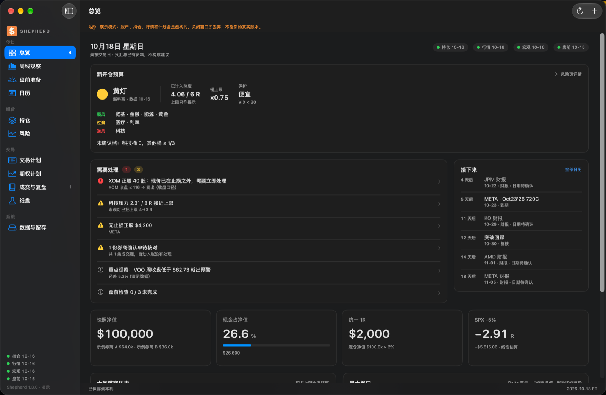
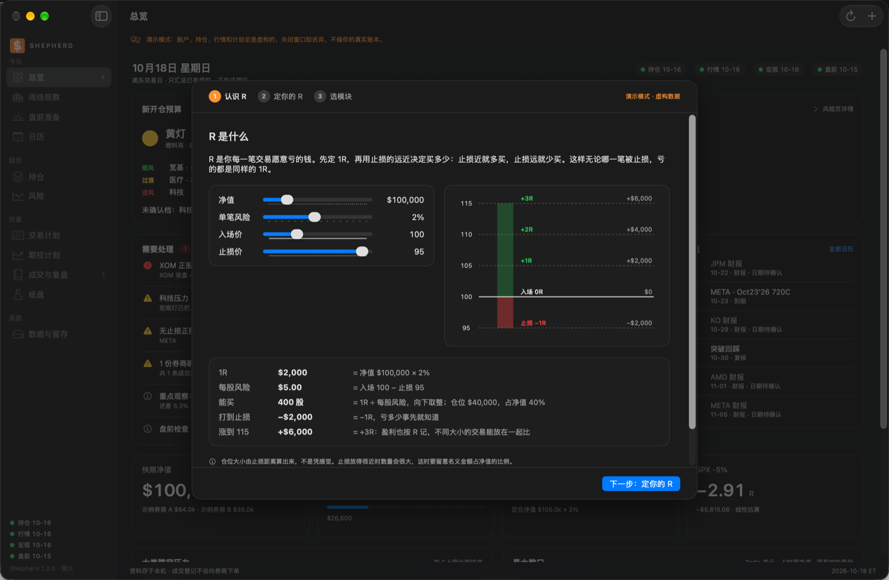
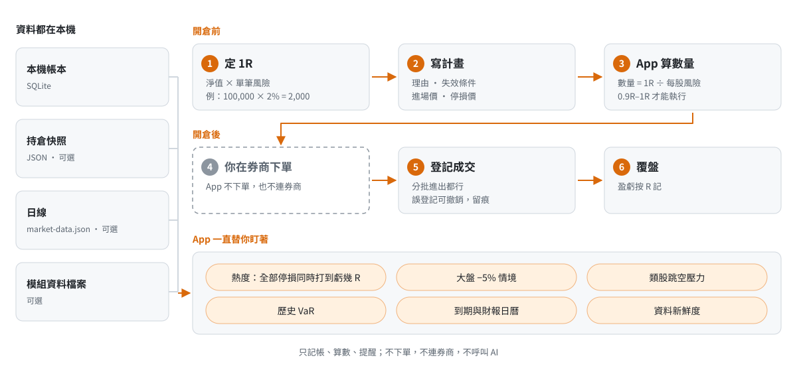
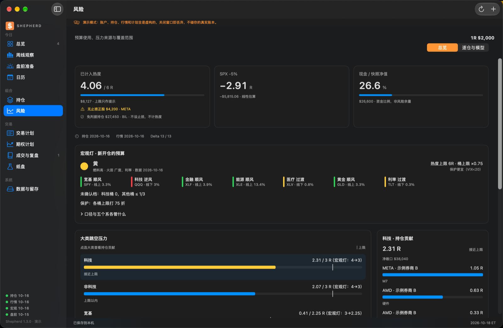
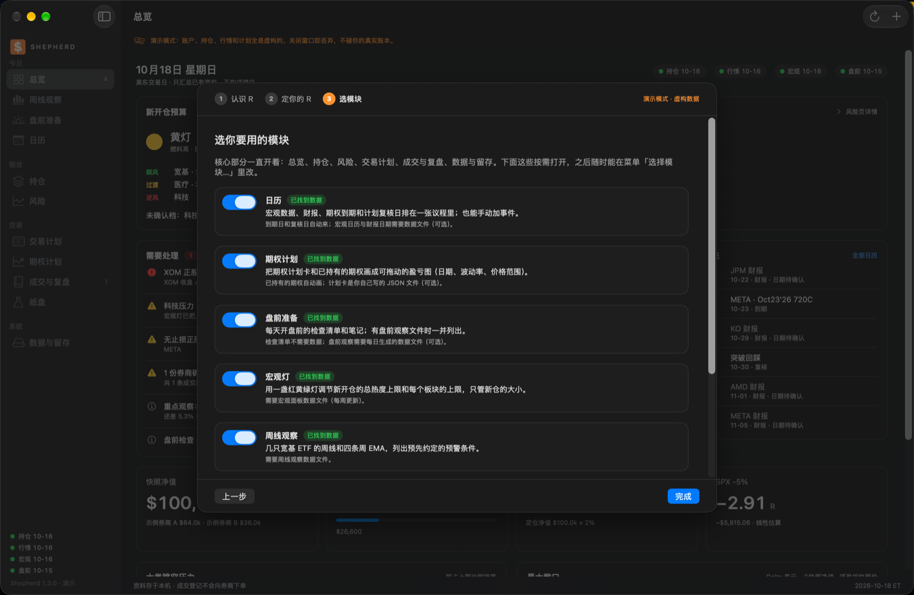
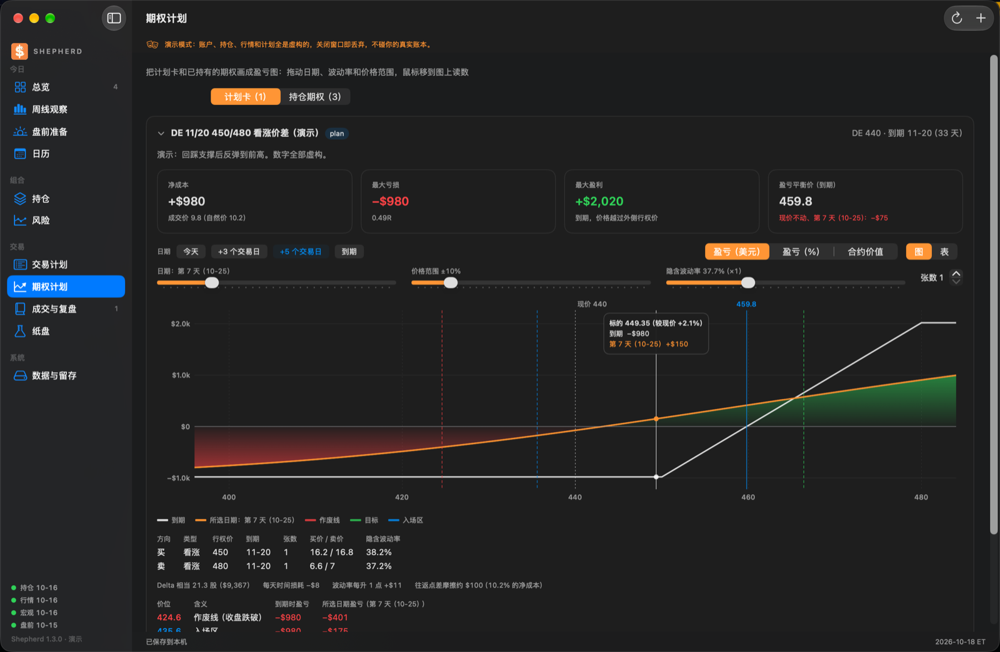

# Shepherd · 以損定倉的交易工作台

[简体中文](README.md) · 繁體中文 · [English](README.en.md)

<p align="center">
  <a href="https://github.com/NexusKFK/shepherd/releases/latest"></a>
  <a href="LICENSE"></a>
  
  <a href="https://github.com/NexusKFK/shepherd/actions/workflows/ci.yml"></a>
</p>

Shepherd 是一個 macOS 本機 App。它幫你在開倉之前把風險算清楚：先定好每筆願意虧的錢（1R），再按停損距離算出該買多少；開倉之後，隨時告訴你"所有停損同時被打到，一共會虧多少 R"。

App 介面目前只有簡體中文，下面提到的選單和按鈕名稱都照介面原文的意思翻成繁體。

它只記帳、算數、提醒。它不下單，不登入券商，不給買賣建議，也不呼叫任何 AI 模型。所有記錄都存在你自己的電腦上。

<p align="center"></p>

> 截圖全部來自演示模式，帳戶、持倉和行情都是隨機生成的。

## 先搞懂 R

R 是你每一筆交易願意虧的錢。Shepherd 裡的一切都圍著它轉。

| | 數字 | 怎麼來的 |
|---|---|---|
| 1R | $2,000 | 淨值 $100,000 × 單筆風險 2% |
| 每股風險 | $5 | 進場 100 − 停損 95 |
| 能買 | 400 股 | 1R ÷ 每股風險，向下取整 |
| 打到停損 | −$2,000 | 正好 −1R，虧多少事先就知道 |
| 漲到 115 | +$6,000 | +3R，獲利也按 R 記 |

停損近就多買，停損遠就少買。這樣無論哪一筆被停損，虧的都是同樣的 1R。第一次打開 App 時，會先用一個能拖曳的例子講這件事，再讓你定自己的 1R。沒有定好 1R，App 不會給出計畫數量。

<p align="center"></p>

## 一張圖看懂

開倉前你定 1R、寫計畫，App 算數量；你在券商下單，回來登記成交；整個過程中 App 一直盯著熱度和風險。

<picture>
  <source media="(prefers-color-scheme: dark)" srcset="docs/img/flow-zh-TW-dark.svg">
  
</picture>

## 快速開始

1. 到 [Releases](../../releases) 下載 `Shepherd-v1.3.0-macOS-arm64.zip`，解壓縮後把 `Shepherd.app` 拖進「應用程式」。目前只提供 Apple 晶片版本，需要 macOS 14 或更新。
2. 第一次打開時，macOS 會提示無法驗證開發者，因為這個 App 沒有做蘋果公證。打開「系統設定 → 隱私權與安全性」，在頁面下方點「強制打開」。
   如果還是打不開，在終端機執行 `xattr -dr com.apple.quarantine /Applications/Shepherd.app`，再打開一次。
3. 跟著首次引導走三步：認識 R，定你的 R，選模組。
4. 想先看看完整的樣子：選單「檔案（File）→ 打開演示（虛構資料）」。演示會另開一個視窗，用一套虛構的帳戶和行情，關掉就丟棄，不碰你的帳本。

## 一直開著的核心部分

| 頁面 | 做什麼 |
|---|---|
| 總覽 | 打開就看到：還能開多少新倉、有什麼要處理、接下來幾天有什麼事、資料新不新。 |
| 持倉 | 所有持倉一張表：浮盈、佔淨值比例、Delta 美元、到期倒數計時，組合可以展開看每條腿。 |
| 風險 | 熱度（所有停損同時打到會虧多少 R）、大盤跌 5% 的線性估算、按板塊的跳空壓力、歷史 VaR。 |
| 交易計畫 | 寫理由、失效條件和退出安排，填進場價和停損價，App 按 1R 算數量。滿足 0.9R–1R 才能標成待執行。 |
| 成交與覆盤 | 登記券商裡已經發生的成交（分批進出都行），誤登記可以撤銷，原記錄留痕。 |
| 資料與留存 | 帳本位置、匯入持倉、快照歷史版本、一鍵匯出完整備份。 |

<p align="center"></p>

## 按需打開的模組

第一次打開時選，之後在選單「檔案（File）→ 選擇模組…」裡隨時改。沒開的模組不出現在側欄，也不會在總覽報提醒，左下角也不顯示它的資料燈。

<p align="center"></p>

| 模組 | 做什麼 | 需要什麼 | 新使用者預設 |
|---|---|---|---|
| 日曆 | 宏觀資料、財報、期權到期、計畫複核日排成一張議程，也能手動加事件。 | 到期日和複核日自動來；宏觀日曆和財報日期要資料檔案（可選）。 | 開 |
| 期權計畫 | 把期權計畫卡和已持有的期權畫成盈虧圖，可以拖曳日期、波動率和價格範圍。 | 已持有的期權自動畫；計畫卡是你寫的 JSON 檔案。 | 開 |
| 盤前準備 | 開盤前的檢查清單和筆記；有盤前觀察檔案時一併列出。 | 清單不需要資料；盤前觀察要資料檔案。 | 關 |
| 宏觀燈 | 一盞紅黃綠燈，調節新開倉的總熱度上限和每個板塊的上限。只管新倉大小，不叫你賣已有的倉。 | 宏觀面板資料檔案（每週更新）。 | 關 |
| 週線觀察 | 幾檔寬基 ETF 的週線和四條週 EMA，列出預先約定的預警條件。 | 週線觀察資料檔案。 | 關 |
| 紙盤 | 只觀察、不下單的模擬交易，按收盤估值，不進真實帳本和風險統計。 | 紙盤估值資料檔案。 | 關 |
| 券商確認單匯入 | 把 Schwab 的成交確認郵件解析成提案，核對後入帳。 | 把確認郵件存進投餵資料夾（可配 Mail 規則自動存）。 | 關 |

<p align="center"></p>

## 資料從哪來

Shepherd 自己不連網取數。你可以從最簡單的用法開始，需要時再接資料。

1. **只用帳本。** 在 App 裡建計畫、登記成交，持倉和熱度就從帳本裡算。不需要任何外部檔案。
2. **匯入持倉快照。** 把券商持倉整理成一個 JSON 檔案，在「資料與留存 → 匯入持倉 JSON」匯入。格式看 [`examples/holdings-template.json`](examples/holdings-template.json)。匯入的是一份副本；持倉變了要重新匯入。
3. **補日線。** 風險頁的 Beta、大盤情景和 VaR 要用日線。執行下面這條命令，它會從 Yahoo 拉日線，寫到 App 的資料目錄：

   ```sh
   python3 tools/fetch_market_data.py AAPL MSFT NVDA   # 換成你持有的代碼；SPY 和標普指數會自動加上
   ```

4. **接模組的資料檔案。** 宏觀燈、週線觀察、紙盤、盤前觀察、日曆都讀一個約定格式的 JSON 檔案。格式見 [docs/data-formats.md](docs/data-formats.md)。最完整的範例是演示資料：執行 `python3 -m workbench.demo --out /tmp/shepherd-demo`，然後看 `sources/` 下面的每個檔案。

作者自己用一套獨立的採集腳本每天生成這些檔案。那套腳本和個人帳戶綁得太緊，沒有放進這個儲存庫。

## 定倉規則

下面是 App 裡寫死的規則。數字是作者的選擇，不是通用建議；你可以 fork 後改 `workbench/` 裡對應的常數。

- 1R = 定倉淨值 × 單筆風險比例。比例預設 2%，上限 4%。淨值是你確認的預算基準，不隨每天的市值自動變。
- 一筆完整計畫要用到 0.9R–1R。數量向下取整，貴的股票或整張期權不會為了湊滿而超出預算。
- 改 1R 只影響之後的新計畫；已經待執行或持倉中的計畫保留當時的 1R。
- 買方期權按全部權利金算風險。賣方結構只支援你確認過每組最大虧損的定義風險結構，裸賣期權不適用。
- 熱度上限預設 8R，只作提示。開了宏觀燈以後，上限跟著燈變。
- 板塊跳空壓力的上限：科技 4R、非科技 4R、寬基 3R、黃金 2R、利率 2R。只作提示。
- 停損預設按收盤價判斷。跳空、滑點和費用會讓實際虧損超過 1R；R 是計畫時的預算，不是保證。

## 設計原則

- **失敗要顯形。** 資料檔案缺失或損壞時，頁面寫明"不可用"或"沒有找到"，不會顯示成"沒有訊號"。
- **本機優先。** 帳本是一個 SQLite 檔案，在 `~/Library/Application Support/Shepherd/TradingDesk/`。升級或刪掉 App 不會動它。
- **只記已經發生的事。** 成交登記只記帳，不會向券商發單。看持倉不會憑空生成歷史成交。
- **介面輕、計算可測。** 介面是 SwiftUI；所有計算在內建的 Python 引擎裡，有 240 多個單元測試。App 自帶執行環境，你不需要裝 Python。

## 從原始碼建置

需要 macOS 14+、Xcode 命令列工具（Swift 5.9+），以及 [python.org](https://www.python.org/downloads/macos/) 的 framework 版 Python 3.10+（用來打包內建執行環境）。

```sh
./build-workbench.sh                 # 生成 .app-build/Shepherd.app（當前機器的 CPU 架構）
./install-workbench.sh               # 裝到 ~/Applications/Shepherd.app，舊版本自動歸檔，帳本不動
python3 -m unittest discover -p 'test_*.py'
```

## 目錄

```
native/Sources/Shepherd/   SwiftUI 介面
workbench/                 計算引擎：帳本、定倉、風險、期權、模組、演示資料
workbench/macos/           打包內建 Python、PDF 文字提取、Mail 規則腳本
examples/                  持倉 JSON 範例
tools/fetch_market_data.py 補日線的小腳本
docs/                      資料格式說明和截圖
```

## 免責聲明

Shepherd 是個人交易記錄和風險計算工具，不是投資建議。所有數字都依賴你輸入的資料和 App 的近似模型（線性 Delta、歷史分位數等），可能和實際結果有差距。交易決定和後果由你自己承擔。

## 授權

[更新記錄](CHANGELOG.md) · [參與貢獻](CONTRIBUTING.md) · [安全說明](SECURITY.md) · [資料格式](docs/data-formats.md)


程式碼以 [GPL-3.0](LICENSE) 釋出。作者：[NexusKFK](https://github.com/NexusKFK)。

作者的另一個專案：[Whirlpool · WP行情帶](https://github.com/NexusKFK/whirlpool)，選單列 LED 跑馬燈行情。
